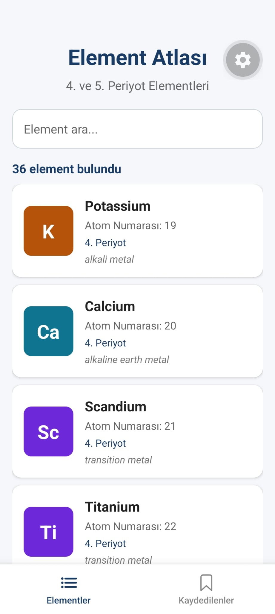
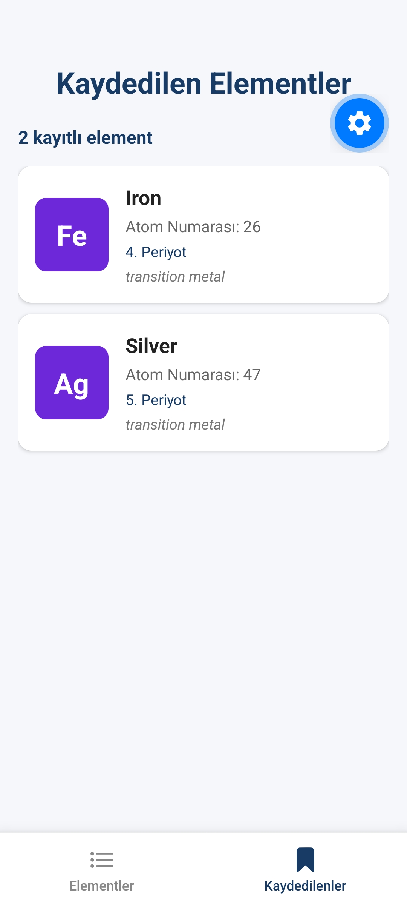

# Element Atlası

## BSM447 - Mobil Uygulama Geliştirme Dönem Ödevi

**Öğrenci No:** B211210583

**Konu:** K10 - Periyodik Tablo

**Varyant:** b - 4. ve 5. Periyot Elementleri

**Ek Kural:** 9 - Paylaş

## Proje Hakkında

Element Atlası, React Native ve Expo kullanılarak
geliştirilmiş bir mobil uygulamadır.

Uygulama, periyodik tablodaki 4. ve 5. periyot
elementlerini bir API üzerinden çekerek listeler.

## Kullanılan Teknolojiler

- React Native
- Expo SDK 58
- JavaScript
- React Navigation
- AsyncStorage
- Fetch API

## Uygulama Özellikleri

- API üzerinden 4. ve 5. periyottaki 36 elementin listelenmesi
- Element adına, sembolüne ve atom numarasına göre arama
- Arama sonucu bulunamadığında bilgilendirici mesaj gösterilmesi
- API bağlantı hatalarında Yeniden Dene butonu
- Elementlerin detay bilgilerinin gösterilmesi
- Atom kütlesinin iki ondalık basamakla gösterilmesi
- Element kategorilerine göre renklendirme
- Element kategorilerinin Türkçe isimlerle gösterilmesi
- Element kategorilerini açıklayan renk rehberi
- Elementleri kaydetme ve kayıttan çıkarma
- AsyncStorage ile kayıtların kalıcı olarak saklanması
- Kaydedilenler boş olduğunda açıklayıcı bilgilendirme
- Element bilgilerinin sistem paylaşım menüsüyle paylaşılması
- React Navigation ile ekranlar arasında geçiş

## API

https://raw.githubusercontent.com/Bowserinator/Periodic-Table-JSON/master/PeriodicTableJSON.json

## Veri Saklama

Kaydedilen elementler AsyncStorage kullanılarak
telefonun yerel hafızasında saklanmaktadır.

## Ekran Görüntüleri

### 1. Elementler Listesi

### 2. Element Detayı

### 3. Kaydedilen Elementler

## Android APK

Element Atlası uygulamasının güncel Android APK sürümü:

[APK Dosyasını İndir](https://expo.dev/accounts/bxmrad/projects/PeriyodikTablo/builds/70e26134-0e61-4835-a942-a601c0bf78b7)

## Uygulama Tanıtım Videosu

Uygulamanın üç ekranını ve temel özelliklerini
gösteren 37 saniyelik tanıtım videosu.

[Tanıtım Videosunu İzle](videos/tanitim.mp4)

## GitHub

https://github.com/bassam-radman/bsm447-odev-B211210583
